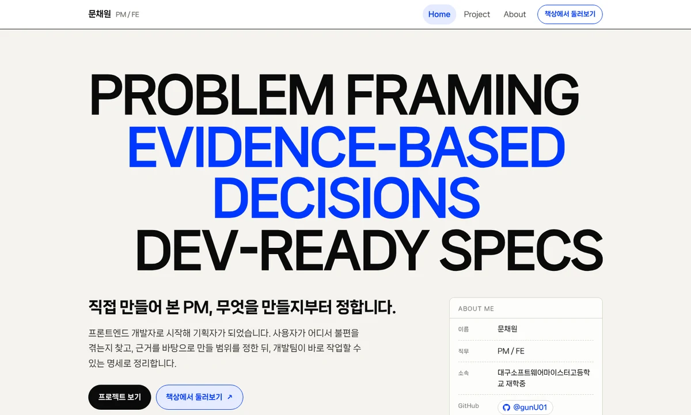
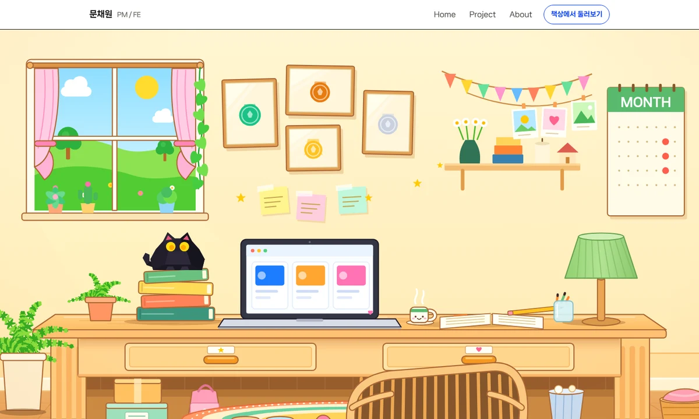
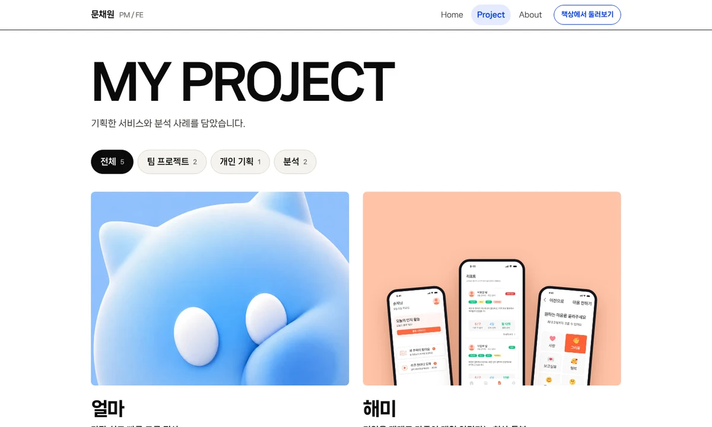
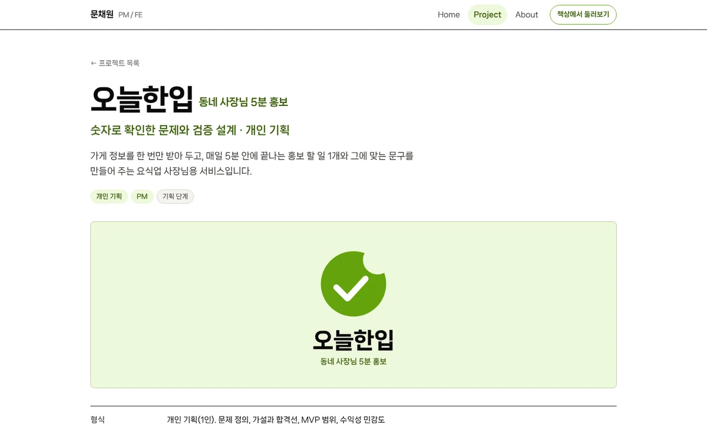
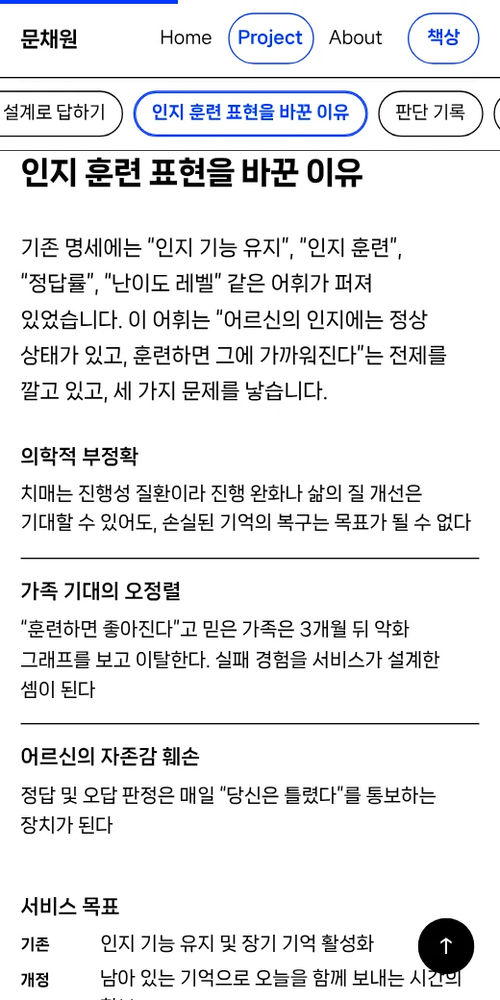

<div align="center">

# 문채원 포트폴리오

**프론트엔드로 시작해 기획자가 된 PM의 프로젝트 기록**
무엇을 만들지 정하는 과정을 근거와 함께 남깁니다.




</div>

<br />

## 어떤 사이트인가요

PM 포트폴리오 한 편을 사이트로 만든 것입니다. 결과물보다 **어떤 문제를 보고, 무엇을 근거로 무엇을 정했는지**를 읽을 수 있게 구성했습니다. 수치는 출처를 확인한 것만 싣고, 팀이 한 일은 '팀'으로 적습니다.

| 페이지 | 내용 |
| --- | --- |
| **Home** | 첫 화면(한 줄 소개, 핵심 문구, 연락처 요약)과 Project, About으로 가는 안내 |
| **Project** | 케이스 5편의 목록 |
| **About** | 활동 기록, 대회 참가, 기술과 도구 |
| **책상** | SVG로 그린 책상 위의 물건을 눌러 포트폴리오를 둘러보는 입구 |

### 프로젝트

| 케이스 | 한 줄 요약 |
| --- | --- |
| **얼마** | 가장 쉽고 빠른 그룹 정산. 가계부에서 정산 하나로 범위를 좁힌 팀 프로젝트(팀장, PM, FE) |
| **해미** | 기억을 매개로 가족이 매일 연결되는 회상 돌봄. 대회 출품 팀 프로젝트(기획 전담, FE) |
| **오늘한입** | 동네 사장님 5분 홍보. 공개 통계로 문제를 확인하고 검증을 설계한 개인 기획 |
| **토스 BM 분석** | 무료 송금 위에 쌓인 수익 구조와 성장의 구성. 공시 자료 기반 분석 |
| **토스 UX 다이어트** | 앱 화면을 직접 확인해 처음 제안을 고치고, 이미 있는 것은 두고 없는 두 가지만 실험하는 서비스 제안 |

<table>
  <tr>
    <td width="50%"></td>
    <td width="50%"></td>
  </tr>
  <tr>
    <td align="center"><sub>책상: 물건을 눌러 둘러보기</sub></td>
    <td align="center"><sub>프로젝트 목록</sub></td>
  </tr>
  <tr>
    <td width="50%"></td>
    <td width="50%" align="center"></td>
  </tr>
  <tr>
    <td align="center"><sub>케이스 본문: 목차, 막대 도식, 접이식 표</sub></td>
    <td align="center"><sub>모바일: 가로 목차 칩, 한 줄 표</sub></td>
  </tr>
</table>

## 만든 방식

- **데이터와 화면의 분리.** 문구와 수치는 `src/data/` 에만 있고, 화면 코드는 그것을 그리기만 합니다. 내용을 고칠 때 화면 코드를 건드릴 일이 없습니다.
- **의존 방향 검사.** `data → lib → components → pages` 계층 규칙을 `npm run arch` 가 기계로 검사합니다(순환, 쓰지 않는 모듈 포함).
- **외부 의존 최소화.** `react`, `react-dom` 외 런타임 패키지가 없고, CDN도 쓰지 않습니다. 글꼴(나눔스퀘어 네오, SIL OFL)은 쓰는 글자만 담아 함께 배포합니다.
- **해시 라우팅.** 정적 호스팅에서 새로고침해도 깨지지 않고, 하위 경로에 올려도 동작합니다.
- **작게 받기.** 홈만 처음에 받고 나머지 페이지는 들어갈 때 받습니다. 모든 페이지가 쓰는 글꼴만 미리 받습니다.
- **접근성과 모션.** 키보드 이동, 대비 4.5:1 이상의 글자색, 목차의 `aria-current`, "동작 줄이기" 설정에서 모든 움직임 끄기, 인쇄 시 접힌 항목 펼치기(PDF 저장 가능).

### 인터랙션

스크롤 진행 막대 · 메뉴 알약 이동 · 카드 기울기 · 버튼 끌림 · 활동 기록 진행선 · 막대 도식 차오름 · 접이식 항목 · 다음 프로젝트 카드 · 맨 위로 버튼 · 책상 장면의 물건별 반응

## 검증 하네스

화면이 바뀌어도 약속이 깨지지 않도록 검사를 코드로 남겼습니다. `npm run verify` 한 번이 아래를 차례로 돌립니다.

| 단계 | 확인하는 것 |
| --- | --- |
| `lint` | 문법, 훅 규칙, 쓰지 않는 변수 |
| `arch` | 계층 규칙, 순환, 쓰지 않는 모듈 |
| `build` | 빌드 성공 |
| `e2e` | 빌드 결과를 실제 브라우저로 열어 확인: 라우트, 접근성, 링크, 모바일 가로 넘침, 움직임, 책상 장면 등 100여 건 |

## 기획 하네스

[`my-react-app/planning/`](my-react-app/planning) 에는 오늘한입의 기획 문서를 검사하는 별도 하네스가 있습니다. 요구사항과 기능이 연결되어 있는지, 근거의 확인 상태(원문 확인, 2차 자료, 확인 자료 없음)를 정직하게 적었는지, 범위를 넘지 않았는지를 `npm run plan` 이 검사합니다. 하네스 자체도 일부러 망가뜨린 모델로 시험합니다(`npm run plan:test`).

## 시작하기

```bash
cd my-react-app
npm install
npm run dev        # 개발 서버
npm run build      # dist/ 생성
npm run verify     # lint + arch + build + e2e
```

내용을 고치려면 `my-react-app/src/data/` 만 수정하면 됩니다. 파일별 역할은 [`my-react-app/README.md`](my-react-app/README.md), 계층 규칙과 데이터 흐름은 [`my-react-app/ARCHITECTURE.md`](my-react-app/ARCHITECTURE.md) 에 있습니다.

## 폴더

```
my-react-app/
  src/
    pages/        Home · Project · Case · About · Desk
    components/   Nav · Footer · Blocks · CaseCover · CaseNext · SkillMap · DeskScene …
    data/         화면에 나오는 모든 문구와 수치
    lib/          훅과 작은 함수 (스크롤, 관찰, 호버, 라우팅 …)
    styles/       CSS (index.css 의 불러오는 순서가 곧 우선순위)
  harness/        아키텍처 검사, 브라우저 검사(checks/), 스냅샷 비교
  planning/       기획 하네스와 오늘한입 기획 문서
  scripts/        글꼴 쪼개기
docs/screens/     README 화면 이미지
```

## 글꼴과 라이선스

글꼴 **나눔스퀘어 네오**(NAVER)는 [SIL Open Font License](https://openfontlicense.org) 로 배포되며 `src/assets/fonts/` 에 함께 담겨 있습니다.

<div align="center">
<sub>문채원 · PM / FE</sub>
</div>
