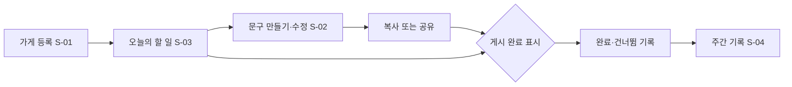

# 화면과 흐름

> 이 문서는 `model/` 의 데이터에서 자동으로 만들어집니다. 직접 고치지 말고 `model/` 을 고친 뒤 `npm run plan:build` 를 실행하세요.

| ID | 화면 | 목적 | 흐름 | 기능 |
| --- | --- | --- | --- | --- |
| S-01 | 가게 등록 | 3분 안에 가게 정보를 입력한다. 입력 항목 3개, 선택 항목 1개(연령대). | 시작 → 상호 → 대표 메뉴 → 특징 한 줄 → (선택) 연령대 → 완료 → 오늘의 할 일(S-03) | F-01 |
| S-02 | 문구 만들기·수정 | 채널을 고르면 문구가 나오고, 고치고, 복사하거나 공유한다. | 채널 선택 → 문구 생성 → 직접 수정 → 복사 또는 공유 → 게시 완료 표시 | F-02, F-04 |
| S-03 | 오늘의 할 일 | 오늘 할 일 한 개와 완료·건너뜀 버튼만 보여 준다. | 알림 → 할 일 확인 → (필요하면 S-02 에서 문구 작성) → 완료 또는 건너뜀(+이유) | F-03, F-05 |
| S-04 | 주간 기록 | 이번 주 완료·건너뜀과 수행률을 보여 준다. | 주간 요약 → 건너뛴 이유 분포 | F-05 |
| S-05 | 밈 고르기 | 밈의 뜻과 어울리는 손님층을 보고 문구에 넣는다(next). | 밈 목록 → 설명 → 문구에 적용 | F-06 |

## MVP 사용 흐름

